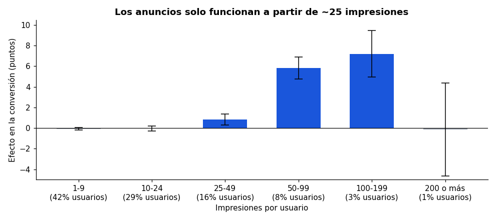
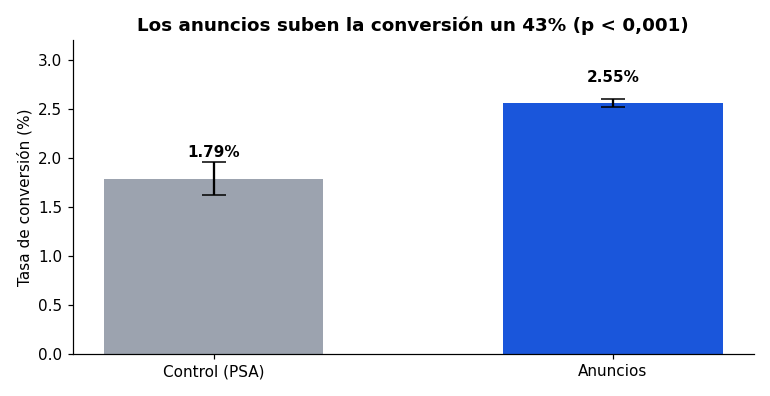
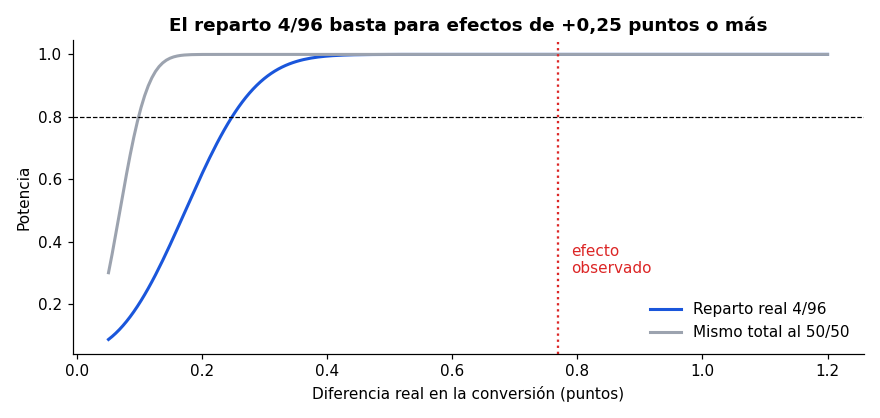

# ¿Funcionan los anuncios? — A/B test de marketing

**Análisis de un experimento real con 588.101 usuarios para decidir si una campaña de anuncios aumenta las compras, cuántas compras se le deben de verdad y para quién funciona.**

[](https://github.com/alvarodc093-pixel/Marketing-AB-Test/actions/workflows/ci.yml)    



## En resumen

- **Problema:** una empresa quiere saber si su campaña de anuncios vende más y cuánto puede pagar por ella.
- **Experimento:** el 96 % de los usuarios ve el anuncio y el 4 % (control) ve un anuncio de servicio público en el mismo hueco. La métrica es la conversión (compra).
- **Métodos:** test z de dos proporciones con intervalos de confianza, bootstrap, enfoque bayesiano (Beta-Binomial), análisis de potencia, regresión logística para ajustar por desequilibrios, y análisis por segmentos con corrección de Holm.
- **Resultado:** los anuncios suben la conversión **+0,77 puntos (+43 %)**. Pero solo el **30 % de las compras** del grupo con anuncios se deben a ellos, y **el 72 % de los usuarios (los que ven menos de 25 anuncios) no responde a la campaña**.

## Hallazgos principales

| # | Pregunta | Respuesta |
|---|---|---|
| 1 | ¿La campaña funciona? | **Sí.** Conversión de 1,79 % a 2,55 %: **+43 %** (IC 95 %: +30 % a +58 %; p ≈ 2·10⁻¹³). Coinciden el test z, el bootstrap y el enfoque bayesiano (probabilidad de que los anuncios sean mejores ≈ 100 %). |
| 2 | ¿Es fiable el resultado? | Los grupos tienen pequeños desequilibrios en impresiones y día, pero al ajustar por ellos el efecto no cambia: +0,76 puntos estandarizado, odds ratio 1,48 en la regresión logística. El experimento detectaba efectos desde +0,25 puntos con un 80 % de potencia. |
| 3 | ¿Cuántas compras se deben a los anuncios? | **~4.340 de 14.423 (30 %)**, con IC de 3.360 a 5.330. El resto habría ocurrido igualmente. Medir la campaña por compras totales la sobrevaloraría más de 3 veces. |
| 4 | ¿Cuánto se puede pagar? | 0,31 compras extra por cada 1.000 impresiones. Con 50 € de margen por compra, la campaña es rentable hasta un **CPM de ~15 €**. |
| 5 | ¿Para quién funciona? | **Solo a partir de ~25 impresiones.** Con 1-24 impresiones (72 % de los usuarios) el efecto es cero. Con 50-99 los anuncios **doblan** la conversión. Por encima de 200 se satura. Los usuarios con 50-199 impresiones, solo el 11 % del total, aportan casi 9 de cada 10 compras extra. |
| 6 | ¿Hay días mejores? | De lunes a miércoles el efecto es claro (martes: +1,6 puntos). El jueves y el domingo no hay efecto significativo. |



## Recomendaciones

1. **Mantener la campaña:** el efecto es grande, estable y rentable si el CPM se queda por debajo de ~0,31 × el margen por compra.
2. **Medirla por compras incrementales, no por compras totales.** Mantener siempre un grupo de control pequeño para seguir midiendo.
3. **Probar con un nuevo experimento** qué hacer con el 72 % de usuarios que ve pocos anuncios y no responde: subirles la frecuencia o dejar de gastar en ellos. Estos datos no lo pueden decidir solos, porque el número de impresiones no se asignó al azar.
4. **Probar a concentrar el presupuesto de lunes a miércoles.**

## Qué hay en el análisis

El [notebook](analisis.ipynb) sigue los pasos de un análisis de experimento real:

1. **Calidad de datos:** un usuario por fila, sin nulos ni duplicados.
2. **Comprobación de la aleatorización:** distribución de impresiones, día y hora en cada grupo. Encuentra un desequilibrio pequeño y lo cuenta.
3. **Resultado principal:** test z, IC de la diferencia (Wald) y del lift relativo (método delta sobre el logaritmo), bootstrap y posterior bayesiana. Después, el mismo efecto ajustado por estratos y con regresión logística.
4. **Potencia:** efecto mínimo detectable con el reparto 96/4 y comparación con un 50/50.
5. **Impacto de negocio:** compras incrementales y CPM máximo rentable según el margen.
6. **Segmentos:** efecto por tramo de impresiones, día y franja horaria, con p-valores corregidos por Holm.
7. **Conclusiones y limitaciones.**



## Cómo está montado

```text
.
├── analisis.ipynb          # el análisis completo, ejecutado
├── ab/
│   ├── estadistica.py      # test z, IC, bootstrap, bayesiano, potencia, tamaño muestral, Holm
│   └── datos.py            # descarga, limpieza y efecto por segmento
├── tests/                  # 14 tests: cada función comparada con statsmodels o scipy
└── docs/img/               # gráficos
```

Las funciones estadísticas están escritas a mano con numpy y scipy, en lugar de llamar a una librería, para poder explicar cada número. Los tests comprueban que dan **lo mismo que statsmodels**: test z, IC de Wald, IC del cociente en escala logarítmica, potencia y corrección de Holm. El CI ejecuta los tests y el notebook completo con los datos reales en cada push.

## Cómo ejecutarlo

```bash
pip install -r requirements.txt
pytest -q
jupyter notebook analisis.ipynb    # descarga los datos de Kaggle la primera vez (sin cuenta)
```

## Limitaciones

- Los grupos no están perfectamente equilibrados y el dataset no explica cómo se asignaron. El efecto se mantiene al ajustar, pero es una advertencia.
- No hay fechas: no se puede ver si el efecto se mantiene en el tiempo ni si hubo efecto novedad.
- El día y la hora son los de más impresiones, no los de la compra.
- No hay importes: el impacto económico depende del margen por compra que se suponga.

Datos: [Marketing A/B Testing](https://www.kaggle.com/datasets/faviovaz/marketing-ab-testing) (Kaggle, licencia CC0).

## English summary

Analysis of a marketing A/B test with 588k users (96 % saw ads, 4 % saw a public service announcement). Ads raise conversion from 1.79 % to 2.55 %, a +43 % lift with a 95 % CI of +30 % to +58 %. The z-test, bootstrap and Bayesian analysis all agree, and the result holds after adjusting for a small group imbalance with stratification and logistic regression. Only ~30 % of the ad group's purchases are incremental. The effect appears only for users with 25+ impressions, while the 72 % of users below that threshold do not respond. Break-even CPM is ~0.31 × margin per purchase. The statistical functions are hand-written and checked against statsmodels in 14 tests.
